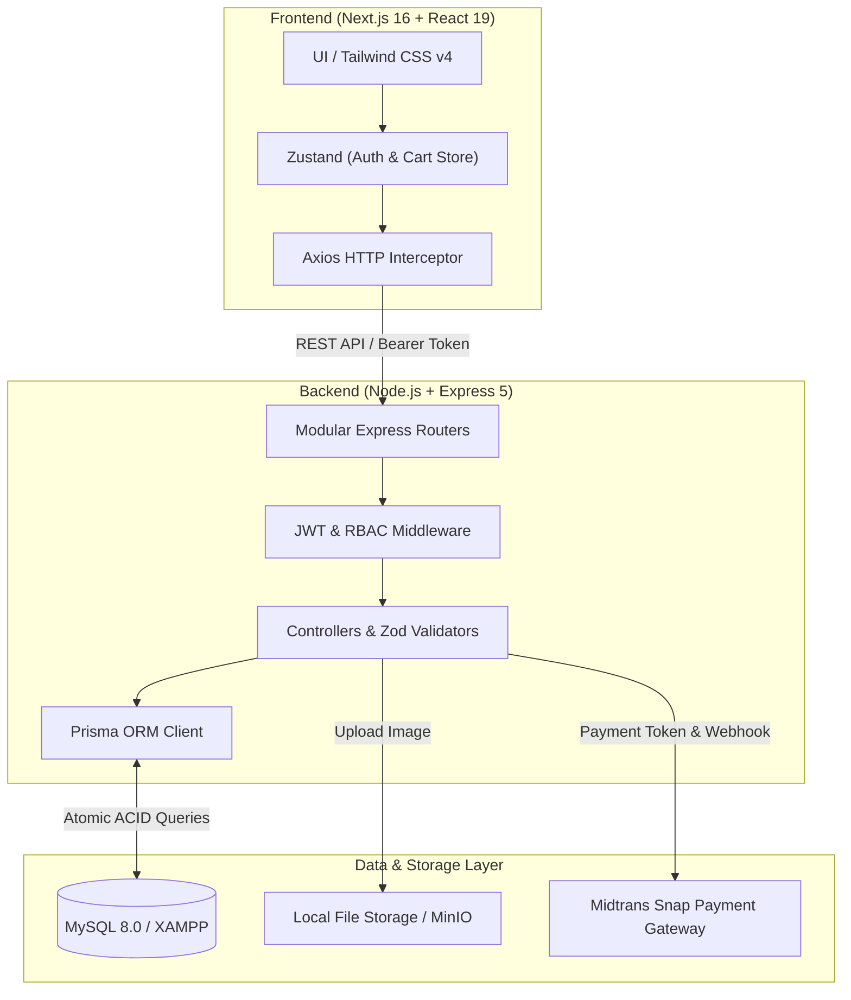
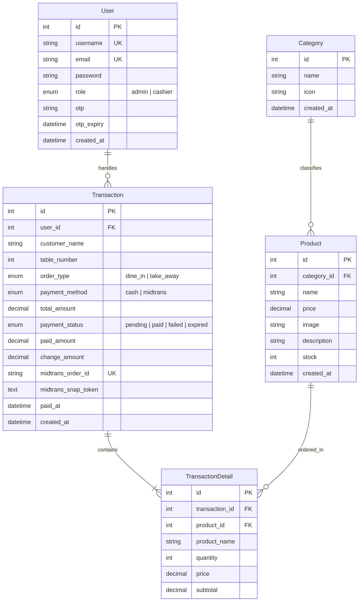
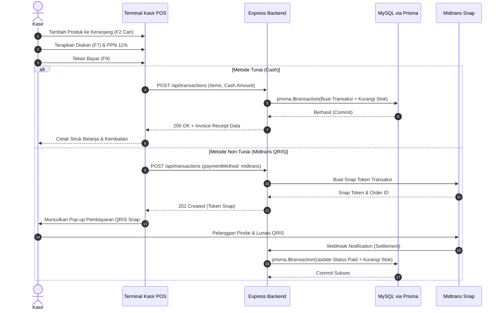

<div align="center">

# 🌾 PadiPos — Modern Enterprise Point of Sale & Retail Management System

### 🏆 Final Capstone Project — Best Graduate Showcase
**Sinau Koding Fullstack Web Development Bootcamp**

[](https://nextjs.org/)
[](https://react.dev/)
[](https://tailwindcss.com/)
[](https://nodejs.org/)
[](https://www.prisma.io/)
[](https://www.mysql.com/)
[](http://localhost:5000/api-docs)

<br />

<p align="center">
  <b>PadiPos</b> adalah platform Point of Sale (POS) dan manajemen inventaris modern generasi terbaru yang dirancang untuk kecepatan kasir, kepastian integritas stok (<i>atomic transactions</i>), serta analisis performa keuangan bisnis ritel dan F&B secara real-time.
</p>

</div>

---

## 📌 Latar Belakang & Ringkasan Proyek

Proyek ini dibangun sebagai **Capstone Project Utama** untuk program **Fullstack Web Development di Sinau Koding Bootcamp**. 

Dalam operasional bisnis F&B dan ritel modern, kendala utama yang sering dihadapi adalah:
1. **Antrean kasir yang lambat** akibat antarmuka dan navigasi checkout yang rumit.
2. **Ketidakcocokan stok fisik dan data sistem** (*stock discrepancy*) akibat transaksi yang tidak atomik saat jam ramai.
3. **Pencatatan kas yang terpisah** antara penjualan tunai, pembayaran non-tunai (QRIS), dan biaya operasional toko.

**PadiPos hadir sebagai solusi komprehensif** dengan antarmuka yang gesit (*clean code*, modular, dan anti-slop), navigasi keyboard kasir berkecepatan tinggi, integrasi payment gateway Midtrans Snap, serta sistem pelaporan analitik bisnis interaktif.

---

## 🏗️ Arsitektur Sistem

PadiPos dibangun dengan arsitektur **Client-Server terpisah (Decoupled Architecture)** yang menjamin skalabilitas, kecepatan render, dan kemudahan pemeliharaan:



---

## 🗄️ Diagram Relasi Entitas (Database ERD)

Skema database dirancang secara terstruktur dan ternormalisasi menggunakan Prisma ORM:



---

## ⚡ Alur Transaksi Atomik (Atomic Checkout Flow)

PadiPos menjamin integritas data inventaris menggunakan transaksi atomik database (`prisma.$transaction`):



---

## 🌟 Fitur Utama Aplikasi

### 🛒 1. Terminal Kasir POS Berkecepatan Tinggi (`/cashier`)
- **Navigasi Keyboard Efisien**:
  - `[F2]`: Akses instan ke pencarian produk.
  - `[F7]`: Modal diskon fleksibel (persentase `%` atau nominal `Rp`).
  - `[F9]`: Tombol pintas bayar / proses pembayaran.
- **Katalog Produk Dinamis**: Tampilan kartu produk beresolusi tinggi dengan foto makanan & minuman asli, indikator stok, dan tombol tambah cepat.
- **Panel Ringkasan Belanja Sticky**:
  - Manajemen item keranjang (tambah, kurangi, hapus item).
  - Perhitungan otomatis Subtotal, Diskon, dan opsi PPN 11%.
  - Rekomendasi nominal uang pas & denominasi tunai cepat (Rp 20.000 s/d Rp 200.000).
  - Integrasi Midtrans Snap untuk QRIS & e-Wallet.
  - **Generator Struk Thermal Siap Cetak** lengkap dengan detail toko, kasir, waktu, dan rincian transaksi.

### 🛡️ 2. Role-Based Access Control (RBAC) & Route Guard
- **Kasir (`cashier` Mode)**:
  - Lingkungan kerja difokuskan hanya untuk transaksi operasional: **Kasir POS**, **Riwayat Transaksi**, dan **Pengaturan Akun**.
  - **Route Guard Aktif**: Upaya akses ke halaman admin (`/admin/*` atau `/expense`) akan ditolak otomatis dan dialihkan ke `/cashier`.
- **Administrator (`admin` Mode)**:
  - Kendali penuh terhadap seluruh sistem: **Dashboard Analitik**, **Katalog & Stok Barang**, **Kategori**, **Riwayat Invoice**, **Pencatatan Pengeluaran Toko**, dan **Pengaturan Sistem**.

### 📦 3. Manajemen Produk & Inventaris (`/admin/product`)
- **Peringatan Stok Menipis**: Banner notifikasi otomatis mendeteksi barang dengan stok mendekati batas minimum (*low stock alert*).
- **Tabel Inventaris Terstruktur**: Pantau SKU, Nama Barang, Kategori, Satuan, Harga Modal, Harga Jual, Margin, dan Status.
- **Form Produk Multipart**: Tambah dan edit produk dilengkapi upload gambar otomatis.
- **Ekspor Data**: Dukungan ekspor katalog produk ke file PDF.

### 📊 4. Dashboard Analitik & Laporan Keuangan (`/admin`)
- **Key Performance Indicators (KPI)**: Total Pesanan Lunas, Total Omzet Penjualan (Rp), dan Total Kuantitas Item Terjual.
- **Visualisasi Recharts**: Grafik batang interaktif (*Bar Chart*) volume penjualan per kategori produk.
- **Drilldown Kategori**: Analisis menu terlaris pada masing-masing kategori secara terperinci.
- **Ekspor Excel 1-Klik**: Unduh seluruh rekap riwayat transaksi ke format `.xlsx` secara instan via endpoint `/api/reports/export`.

### 💸 5. Catatan Kas Keluar & Pengeluaran Toko (`/expense`)
- Pencatatan arus kas operasional harian toko (pembelian bahan baku, listrik, air, perlengkapan kasir, dll).
- Ringkasan statistik pengeluaran hari ini dan akumulasi total kas keluar.
- Filter kategori pengeluaran dan metode pencairan dana.

### 🌓 6. Dark Mode & Desain Minimalis Anti-Slop
- Engine tema dinamis (**Mode Terang & Mode Gelap**) menggunakan standar Tailwind CSS v4 (`@custom-variant dark`).
- Palet warna kontras tinggi, tipografi modern, dan transisi halus.

---

## 🛠️ Tech Stack & Spesifikasi Teknis

| Kategori | Teknologi | Deskripsi |
| :--- | :--- | :--- |
| **Frontend Framework** | **Next.js 16.1.4** (Turbopack) | React framework generasi terbaru dengan App Router |
| **UI Library** | **React 19.2.3** | Library antarmuka komponen reaktif |
| **Styling & CSS** | **Tailwind CSS v4** | Utility-first CSS engine dengan varian Dark Mode |
| **State Management** | **Zustand 5.0.10** | State global ringan untuk Autentikasi & Keranjang Kasir |
| **Data Visualization** | **Recharts 3.7.0** | Grafik analitik interaktif |
| **Iconography** | **Lucide React** | Ikon modern, konsisten, dan ringan |
| **Notifikasi** | **React Hot Toast** | Toast notifications responsif |
| **Backend Runtime** | **Node.js 20+** & **Express 5** | REST API engine dengan routing modular |
| **ORM & Database** | **Prisma 6** & **MySQL (XAMPP)** | Manajemen skema, migrasi, dan query database atomik |
| **API Documentation** | **Swagger UI Express** | Dokumentasi interaktif OpenAPI 3.0 di `/api-docs` |
| **Payment Gateway** | **Midtrans Snap SDK** | Pembayaran digital QRIS & virtual account |
| **Spreadsheet Engine**| **ExcelJS** | Pembuatan dan ekspor file spreadsheet `.xlsx` |

---

## 🔑 Kredensial Akun Demo (Pre-seeded)

Database telah dilengkapi data seeder lengkap untuk pengujian langsung:

| Peran (Role) | Username | Password | Email | Akses Halaman |
| :--- | :--- | :--- | :--- | :--- |
| **Administrator** | `admin` | `password` | `admin@mail.com` | Akses penuh seluruh modul & dashboard analitik |
| **Kasir (Cashier)** | `cashier2` | `Wa1234567@` | `cashier2@mail.com` | Terminal Kasir POS & Riwayat Transaksi |

---

## 🚀 Panduan Instalasi & Menjalankan Proyek

### 1. Prasyarat Sistem
- **Node.js**: Versi `>= 18.x` (Disarankan Node.js 20 LTS)
- **XAMPP**: Layanan **Apache & MySQL** dalam keadaan aktif (Port MySQL: `3306`)
- **Database**: Buat database baru bernama `db_pos` di phpMyAdmin (`http://localhost/phpmyadmin`)

---

### 2. Setup Backend (`backend-pos`)

```bash
# 1. Pindah ke direktori backend
cd e:\Development\backend-pos

# 2. Install seluruh dependensi
npm install

# 3. Pastikan konfigurasi .env sesuai dengan database MySQL
# PORT=5000
# DATABASE_URL="mysql://root:@localhost:3306/db_pos"
# JWT_SECRET="your_jwt_secret_key"

# 4. Sinkronkan skema database Prisma ke MySQL
npx prisma db push

# 5. Jalankan Master Seeder (Akun Demo, Kategori, Produk Berfoto, & Transaksi Riil)
npm run seed

# 6. Jalankan server backend development (Port 5000)
npm run dev
```

> 📖 **Dokumentasi API Swagger**: Buka browser ke **[http://localhost:5000/api-docs](http://localhost:5000/api-docs)** untuk mencoba dan menguji seluruh API secara langsung.

---

### 3. Setup Frontend (`frontend-pos`)

```bash
# 1. Pindah ke direktori frontend
cd e:\Development\frontend-pos

# 2. Install seluruh dependensi
npm install

# 3. Pastikan konfigurasi URL API pada .env.local
# NEXT_PUBLIC_API_URL=http://localhost:5000

# 4. Jalankan server frontend Next.js (Port 3000)
npm run dev
```

> 🌐 **Akses Aplikasi**: Buka browser ke **[http://localhost:3000](http://localhost:3000)** dan login dengan akun Admin atau Kasir.

---

## 📑 Struktur Direktori Proyek

```plaintext
frontend-pos/
├── public/                     # Aset statis, logo resmi PadiPos, & foto produk
│   ├── logo.png                # Logo resmi PadiPos
│   └── products/               # Gambar dummy produk kuliner beresolusi tinggi
├── src/
│   └── app/
│       ├── (auth)/             # Modul login, register, forgot-password, reset
│       ├── (dashboard)/        # Layout utama sistem POS dengan proteksi rute
│       │   ├── admin/          # Dashboard Laporan & Statistik penjualan
│       │   │   ├── category/   # Manajemen kategori barang
│       │   │   └── product/    # Manajemen katalog barang & inventaris stok
│       │   ├── cashier/        # Terminal kasir POS interaktif (F2, F7, F9)
│       │   ├── expense/        # Modul pencatatan kas keluar operasional
│       │   ├── setting/        # Pengaturan profil akun & ubah password
│       │   └── transaction/    # Riwayat invoice transaksi & ekspor Excel
│       ├── components/         # Komponen UI modular (Header, Sidebar, Modals)
│       ├── lib/                # Konfigurasi Axios client & request interceptor
│       ├── store/              # Zustand global state (authStore, cartStore)
│       └── globals.css         # Styling kustom & integrasi Dark Mode Tailwind v4
└── package.json
```

---

## 🏆 Penghargaan & Pengakuan (Acknowledgements)

> *"Proyek ini dikembangkan dengan dedikasi penuh sebagai bukti penguasaan kompetensi Fullstack Web Engineering berstandar industri dalam program **Sinau Koding Bootcamp**, mencakup clean architecture, atomisitas data transaksi, desain UI/UX minimalis, serta dokumentasi API kelas enterprise."*

**Ucapan Terima Kasih:**
- Seluruh Mentor dan Instruktur di **Sinau Koding Bootcamp** atas bimbingan dan kurikulum terbaiknya.
- Rekan-rekan peserta bootcamp seperjuangan atas kolaborasi dan diskusinya.

---

<div align="center">
  <b>© 2026 PadiPos System. All Rights Reserved.</b><br />
  <i>Capstone Project — Best Graduate Showcase, Sinau Koding Bootcamp</i>
</div>
